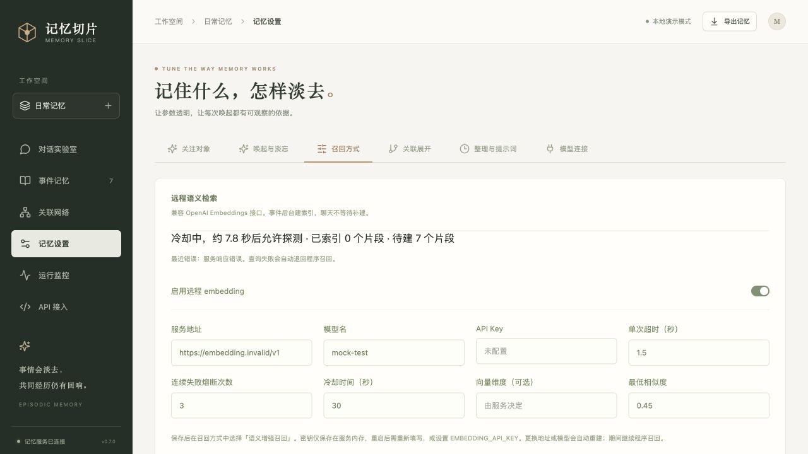

# 0.7.0 / AstrBot 0.3.0 验收记录

日期：2026-10-29。移除生成式 LLM 联想召回，恢复可选远程 embedding；默认程序召回。

## 自动测试

- 核心与 HTTP 接口：127 项通过（`python3 -m unittest discover -s backend/tests`）。
- 打包后的 AstrBot 核心、宿主替身和内嵌网页：28 项通过（`python3 -m unittest discover -s plugins/tests`）。包括真实本机临时端口的启动、占用和退出检查。
- 前端：17 项通过（`npm test`）；TypeScript + Vite 生产构建成功。
- 修改的核心模块 F 类静态检查及 `git diff --check` 通过。
- ZIP 中 19 个核心源文件与当前源码逐字节一致，清单 SHA256 校验通过。

## 故障覆盖

超时、连接错误、401/403、429、5xx、重定向、无效 JSON、错误索引序号、空向量、零向量、非数字、NaN、溢出数值均降级，不向调用者暴露服务商错误原文或密钥。验证了失败结果与程序召回结果一致、HTTP chat 仍返回正常回复、AstrBot 仍注入记忆并保存回复。

连续失败触发熔断，冷却期不发送请求；冷却后只放行一个探测，成功恢复。取消任务释放并发槽位；相同配置重载不会重置熔断。验证了未建/部分索引、正文末尾分片、事件编辑/删除、模型更换、维度变化和配置中途改变；过期或不兼容向量不会参与召回。

接口测试覆盖配置校验错误不回显密钥、状态/监控无密钥、AstrBot 网页只读配置。旧 llm 默认配置迁移为 local，显式旧 llm 召回请求返回 422。程序模式不调用任何向量模型或生成式模型。

## 页面验收

使用隔离的本机 8094 服务、临时数据库和模拟 HTTP 503 transport；未更换用户现有 Docker 或使用用户密钥。保存连接、测试失败、选择 hybrid、发送对话后正常召回「陨石一号」及后续事件；监控显示降级、索引进度、错误和熔断倒计时。配置页截图为模拟故障，非真实服务事故。

## 验证边界

远程协议和语义候选融合使用可控 HTTP/向量替身；没有调用真实 embedding 服务，因此不构成中文语义准确率或真实延迟评测。没有在真实 Windows AstrBot 上安装；插件测试使用宿主 API 替身。当前精确余弦检索扫描空间向量，未做大规模压力测试。
